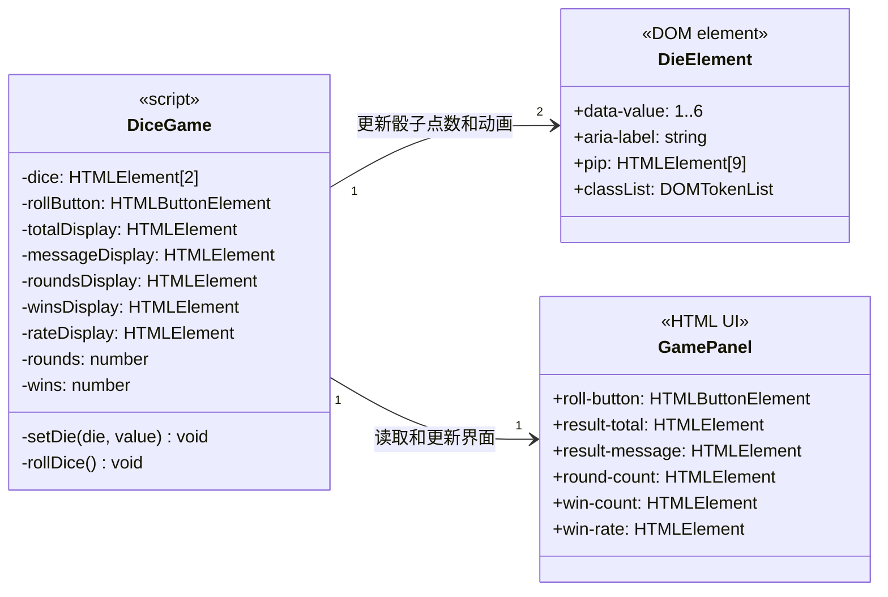

# 掷出幸运 7：UML 类图

## 主要流程

1. 用户点击 `roll-button`，触发 `rollDice()`。
2. 两颗骰子播放动画后，各自随机生成 `1` 到 `6` 的点数。
3. 将两颗骰子的点数相加；总和为 `7` 时记为命中。
4. 更新本次结果、已掷次数、命中次数和命中率。

> **说明：** 当前 `script.js` 使用函数和模块级变量，并没有声明 JavaScript `class`。图中的 `DiceGame`、`DieElement` 和 `GamePanel` 是根据现有脚本及 HTML 职责抽象出的 UML 类，用于说明结构，并非代码中实际存在的类。
